# GraCitas  — Plataforma de Gestión y Reserva de Canchas Sintéticas

<p align="center">
  
</p>

<p align="center">
  <strong>Sistema integral para la consulta en tiempo real, reserva deportiva y administración de complejos de fútbol con gras sintético en Coracora, Parinacochas, Ayacucho, Perú.</strong>
</p>

<p align="center">
  <a href="https://laravel.com"></a>
  <a href="https://www.php.net"></a>
  <a href="https://laravel.com/docs/reverb"></a>
  <a href="https://jwt.io"></a>
  <a href="https://laravel.com/docs/rate-limiting"></a>
  <a href="https://swagger.io"></a>
  
  
  <a href="LICENSE"></a>
</p>

---

##  Tabla de Contenidos

1. [Descripción General](#-descripción-general)
2. [Características Principales](#-características-principales)
3. [Tecnologías y Stack](#-tecnologías-y-stack)
4. [Roles y Permisos](#-roles-y-permisos-rbac)
5. [Cuentas de Demostración](#-cuentas-de-demostración)
6. [Instalación y Configuración](#-instalación-y-configuración)
7. [WebSockets con Laravel Reverb](#-websockets-con-laravel-reverb)
8. [Documentación API (Swagger / OpenAPI 3.0)](#-documentación-api-swagger--openapi-30)
9. [Soporte Multilingüe](#-soporte-multilingüe-es--en--fr)
10. [Manual de Usuario](#-manual-de-usuario-comercial)
11. [Flujo de Trabajo Git Flow](#-flujo-de-trabajo-git-flow)
12. [Pruebas Automatizadas](#-pruebas-automatizadas)
13. [Licencia](#-licencia)

---

##  Descripción General

**GraCitas** nace como una solución moderna orientada al comercio local en **Coracora (Ayacucho)**, facilitando que los deportistas y equipos de fútbol verifiquen la disponibilidad exacta de canchas sintéticas (F5, F7, F8) en segundos, aparten su turno sin riesgo de colisiones horarias y cancelen su reserva en ventanilla al momento del juego (Efectivo / Yape / Plin).

Para los dueños de complejos deportivos y los administradores generales, la plataforma centraliza la configuración de tarifas diurnas/nocturnas, horarios de atención, bloqueos por mantenimiento, registro de cobros presenciales y estadísticas de ocupación e ingresos en tiempo real.

---

##  Características Principales

- **Landing Page E-Commerce & Mobile Marketing (Mobile First)**:
  - Cabecera hero con propuesta de valor B2C en Coracora (*"Reserva tu cancha sintética en Coracora en menos de 1 minuto"*), buscador y CTA directo `[Ver Canchas Disponibles]`.
  - Flujo logístico visual en 3 pasos: (1) Elige cancha y horario, (2) Paga seguro (total o abono), (3) ¡Recibe confirmación y a jugar!
  - Catálogo e-commerce de canchas populares con especificaciones de grass sintético, capacidad de jugadores, tarifas y botón de reserva directa.
  - Prueba social (Social Proof) con testimonios reales de capitanes de Coracora y calificación 5 estrellas.
  - Sección de captación B2B (*"¿Eres dueño de una cancha? Únete como Partner"*) para dueños de locales deportivos.
  - Cumplimiento legal y pasarelas de pago: Términos y Condiciones (`/terminos`), Políticas de Privacidad (`/privacidad` - Ley N° 29733), Libro de Reclamaciones, IziPay, Niubiz, Yape, Plin y Efectivo en ventanilla.
- **Seguridad Avanzada con JWT (JSON Web Tokens)**:
  - Autenticación criptográfica sin estado con algoritmo HMAC SHA-256 (`tymon/jwt-auth`).
  - Emisión de tokens de acceso (`access_token`), tiempo de expiración configurable (`expires_in`) y renovación segura (`/api/auth/refresh`).
  - Claims personalizados integrados en el payload (rol, estado activo, email, nombre).
  - Invalidación y revocación inmediata mediante lista negra en el logout (`/api/auth/logout`).
- **Limitación de Tasa y Protección contra Abuso (Rate Limiting)**:
  - Protección contra ataques de fuerza bruta, credential stuffing y flooding mediante middleware `throttle`.
  - Endpoints de autenticación API (`/api/auth/login`, `/api/auth/register`) limitados a 5 intentos/minuto por credencial e IP.
  - Acceso Web (`/login`, `/register`) con bloqueo por IP/cuenta y respuesta amigable 429 con vista institucional dedicada (`errors/429.blade.php`).
  - Consulta de disponibilidad pública limitada a 60 peticiones/minuto y recuperación de contraseñas a 3 intentos/minuto.
- **Actualizaciones en Tiempo Real (Laravel Reverb)**:
  - Eventos de difusión por WebSockets nativos (`cancha.{id}` y canal privado `establecimiento.{id}`).
  - Actualización inmediata del calendario de disponibilidad cuando otro usuario reserva o cancela.
  - Alertas flotantes (toasts) instantáneas para los propietarios cuando reciben una nueva reserva.
-  **Soporte Multilingüe Completo (ES / EN / FR)**:
  - Selector dinámico de idioma en la cabecera (Español 🇪🇸, Inglés 🇬🇧, Francés 🇫🇷).
  - Persistencia de idioma mediante sesión y cookies, respetando el atributo HTML `<html lang="...">`.
  - Diccionarios completos de traducción tanto en formato PHP (`lang/{locale}/messages.php`) como JSON (`lang/{locale}.json`).
-  **Documentación Interactiva Swagger / OpenAPI 3.0**:
  - UI interactiva integrada en `/api/documentation`.
  - Especificación OpenAPI disponible en `/api/openapi.json`.
  - Exploración y prueba de endpoints de disponibilidad, autenticación y canales WebSocket.
-  **Seguridad y Verificación de Correo**:
  - Verificación por correo electrónico con pantalla de aviso personalizada y protección por middleware (`EnsureEmailIsVerifiedCustom`).
  - Recuperación de contraseña mediante enlace seguro enviado por email.
-  **Gestión por Roles y Permisos (RBAC)**:
  - Vistas, barras de navegación y políticas de acceso personalizadas para **Administrador**, **Propietario** y **Cliente**.
-  **Modelo de Pago Presencial Adaptado a la Región**:
  - Sin necesidad de pasarelas de pago con comisiones bancarias elevadas.
  - Generación de comprobante digital con código de reserva único para pago presencial en el local.
-  **Diseño Responsivo y Experiencia de Usuario Moderna**:
  - Interfaz limpia, optimizada para móviles y tablets con paleta de colores institucional y tipografía Plus Jakarta Sans / Outfit.

---

##  Tecnologías y Stack

| Capa | Tecnologías |
|------|-------------|
| **Backend** | [PHP 8.5](https://www.php.net), [Laravel 12 / 13](https://laravel.com) |
| **Tiempo Real** | [Laravel Reverb](https://laravel.com/docs/reverb), [Laravel Echo](https://github.com/laravel/echo), Pusher JS |
| **Base de Datos** | [MySQL 8.x](https://www.mysql.com) / SQLite (para pruebas unitarias rápidas) |
| **API & Docs** | [OpenAPI 3.0.3](https://swagger.io/specification/), [Swagger UI 5.x](https://swagger.io/tools/swagger-ui/) |
| **Internacionalización** | Middleware `SetLocale`, Laravel Localization (`es`, `en`, `fr`) |
| **Frontend** | Blade Templates, CSS3 Moderno (Custom Properties, Flexbox, Grid), JavaScript ES6+ |
| **Testing & Calidad** | [PHPUnit 12](https://phpunit.de), [Laravel Pint](https://laravel.com/docs/pint) (PSR-12) |
| **Metodología Git** | [Git Flow](https://nvie.com/posts/a-successful-git-branching-model/) (`main`, `develop`, `feature/*`, `release/*`) |

---

##  Roles y Permisos (RBAC)

```mermaid
graph TD
    User([Usuario Registrado]) -->|Rol| Admin[Administrador General]
    User -->|Rol| Owner[Propietario de Local]
    User -->|Rol| Client[Cliente / Futbolista]

    Admin --> A1[Dashboard y KPIs Globales]
    Admin --> A2[Gestión de Usuarios y Roles]
    Admin --> A3[Supervisión de Locales y Canchas]
    Admin --> A4[Supervisión de Reservas y Pagos]
    Admin --> A5[Reportes y Auditoría]

    Owner --> O1[Dashboard de Ocupación]
    Owner --> O2[Gestión de Establecimiento y Fotos]
    Owner --> O3[Canchas, Medidas y Tarifas]
    Owner --> O4[Horarios de Atención Semanales]
    Owner --> O5[Bloqueos por Mantenimiento]
    Owner --> O6[Recepción de Reservas y Alertas Reverb]
    Owner --> O7[Registro de Cobros Presenciales]

    Client --> C1[Explorar Catálogo con Filtros]
    Client --> C2[Disponibilidad en Vivo en 2 Clics]
    Client --> C3[Confirmación de Reserva]
    Client --> C4[Comprobante Digital con Código]
    Client --> C5[Historial de Reservas y Cancelaciones]
```



---


##  Instalación y Configuración

### 1. Requisitos Previos
- **PHP** >= 8.2 (con extensiones `pdo_mysql`, `curl`, `mbstring`, `openssl`, `intl`, `xml`).
- **Composer** 2.x
- **MySQL** 8.x o MariaDB (o XAMPP).
- **Node.js** >= 18 y NPM (opcional para desarrollo frontend).

### 2. Clonar el Repositorio
```bash
git clone https://github.com/marxcuadros24-png/gracitas.git
cd gracitas
```

### 3. Instalar Dependencias PHP
```bash
composer install
```

### 4. Configurar Variables de Entorno
Copia el archivo de ejemplo y genera la clave criptográfica:
```bash
cp .env.example .env
php artisan key:generate
```

Edita `.env` con las credenciales de tu base de datos:
```env
APP_NAME=GraCitas
APP_ENV=local
APP_DEBUG=true
APP_URL=http://localhost:8000

DB_CONNECTION=mysql
DB_HOST=127.0.0.1
DB_PORT=3306
DB_DATABASE=gracitas
DB_USERNAME=root
DB_PASSWORD=

BROADCAST_CONNECTION=reverb
REVERB_APP_ID=gracitas-app
REVERB_APP_KEY=gracitas-key
REVERB_APP_SECRET=gracitas-secret
REVERB_HOST=127.0.0.1
REVERB_PORT=8080
REVERB_SCHEME=http
```

### 5. Migraciones y Seeders
Crea las tablas e inserta los datos de prueba y catálogo:
```bash
php artisan migrate --seed
```
*(Alternativamente, puedes importar el volcado SQL provisto en `gracitas.sql`)*.

### 6. Iniciar el Servidor de Aplicación
```bash
php artisan serve
```
La aplicación estará accesible en: [http://127.0.0.1:8000](http://127.0.0.1:8000)

---

##  WebSockets con Laravel Reverb

Para activar la transmisión en vivo de reservas y notificaciones para propietarios:

```bash
php artisan reverb:start
```

- **Puerto por defecto:** `8080`
- **Canal Público:** `cancha.{canchaId}` (evento `disponibilidad.actualizada`)
- **Canal Privado:** `establecimiento.{establecimientoId}` (evento `.reserva.notificada`)

---

##  Documentación API (Swagger / OpenAPI 3.0)

La API RESTful cuenta con documentación interactiva bajo la especificación OpenAPI 3.0:

- **Interfaz Gráfica Swagger UI:** [http://127.0.0.1:8000/api/documentation](http://127.0.0.1:8000/api/documentation)
- **Esquema JSON OpenAPI:** [http://127.0.0.1:8000/api/openapi.json](http://127.0.0.1:8000/api/openapi.json)

### Endpoints Principales:
- `GET /cancha/{cancha}/disponibilidad?fecha=YYYY-MM-DD`: Consulta de bloques horarios libres y ocupados.
- `GET /api/user`: Información del usuario autenticado (Tokens Bearer / Cookies de sesión).
- `POST /broadcasting/auth`: Autenticación de canales privados WebSocket para propietarios.

---

##  Soporte Multilingüe (ES / EN / FR)

GraCitas soporta tres idiomas accesibles desde la barra de navegación:
- **Español (ES)**: `http://127.0.0.1:8000/lang/es` (idioma predeterminado)
- **English (EN)**: `http://127.0.0.1:8000/lang/en`
- **Français (FR)**: `http://127.0.0.1:8000/lang/fr`

La selección se guarda automáticamente en la sesión del usuario y en una cookie de larga duración para recordar la preferencia en futuras visitas.

---

## Manual de Usuario Comercial

El proyecto incluye un manual de usuario integral de 19 páginas diseñado con enfoque comercial y capturas reales del DOM:

- **Markdown:** [`docs/MANUAL_DE_USUARIO.md`](docs/MANUAL_DE_USUARIO.md)
- **HTML Comercial con Carátula:** [`docs/MANUAL_DE_USUARIO.html`](docs/MANUAL_DE_USUARIO.html)
- **Documento PDF Listo para Imprimir:** [`docs/MANUAL_DE_USUARIO_FINAL.pdf`](docs/MANUAL_DE_USUARIO_FINAL.pdf)
- **Galería de 14 Capturas del DOM:** Ubicadas en `docs/capturas/` mostrando cada módulo del sistema (Inicio, Login, Registro, Detalle de Canchas, Dashboards de los tres roles, Pagos, Reservas y Documentación Swagger).

---

##  Flujo de Trabajo Git Flow

El repositorio sigue estrictamente el modelo de ramificación **Git Flow**:

```text
main (v2.0.0, v2.1.0) ──●───────────────●──── (Producción Estable)
                         \             /
develop                   ●─────●─────●────── (Integración Continua)
                               / \   /
feature/multilanguage         ●───●─●         (Nuevas Funcionalidades)
```

- **`main`**: Código de producción estable, protegido y etiquetado con versiones semánticas (`v2.0.0`, `v2.1.0`).
- **`develop`**: Rama base para integración diaria y consolidación de features.
- **`feature/*`**: Ramas de desarrollo creadas a partir de `develop` y reintegradas mediante merges `--no-ff`.
- **`release/*`**: Ramas de preparación de versión antes de mergear en `main` y sincronizar en `develop`.

---

##  Pruebas Automatizadas

La aplicación cuenta con una suite de pruebas automatizadas con **PHPUnit 12**:

```bash
# Ejecutar todas las pruebas con PHPUnit
php vendor/bin/phpunit -c phpunit.xml

# O mediante Artisan
php artisan test
```

### Cobertura de Pruebas:
- `tests/Feature/LandingPageTest.php`: Verificación integral de la landing page mobile-marketing, titular hero, 3 pasos de reserva, catálogo e-commerce de canchas populares, prueba social B2C, captación B2B, pie de página y páginas legales (`/terminos` y `/privacidad`).
- `tests/Feature/RateLimitingTest.php`: Protección contra fuerza bruta en login web/API, límite de peticiones de registro, protección de endpoint de recuperación de contraseñas, validación de cabeceras `Retry-After`, `X-RateLimit-Limit` y respuesta HTTP 429.
- `tests/Feature/JwtAuthenticationTest.php`: Emisión de tokens Bearer JWT, validación de credenciales, decodificación de claims (rol, activo), endpoint `/api/auth/me`, refresco y logout/revocación.
- `tests/Feature/LocaleTest.php`: Cambio entre idiomas (ES, EN, FR), middleware de sesión, persistencia y rechazo de locales no válidos.
- `tests/Feature/SwaggerDocumentationTest.php`: Disponibilidad del Swagger UI y validación estructural del JSON OpenAPI 3.0.
- `tests/Feature/ReverbBroadcastTest.php`: Validación de eventos en canales públicos y privados de WebSockets.
- `tests/Feature/EmailVerificationTest.php`: Flujo de verificación de correo electrónico institucional.

---

##  Licencia

Este proyecto está bajo la Licencia **MIT**. Consulta el archivo `LICENSE` para más información.

---

<p align="center">
  <strong>GraCitas Coracora</strong> — Desarrollado con para el fútbol ayacuchano y la modernización deportiva.
</p>
