<div align="center">

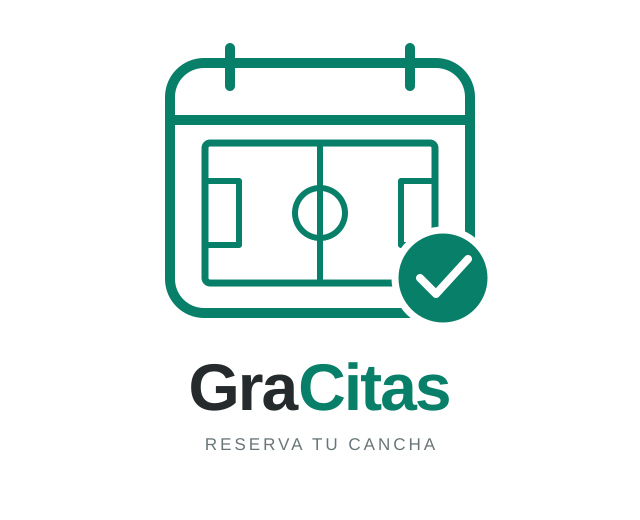

# MANUAL DE USUARIO
### SISTEMA WEB DE GESTIÓN Y RESERVA DE CANCHAS DE GRAS SINTÉTICO

**Guía Oficial de Operación para Clientes, Propietarios y Administradores**

---

| Información del Documento | Detalle |
| :--- | :--- |
| **Producto** | **GraCitas** — Plataforma Integral de Reservas Deportivas |
| **Edición** | Versión Comercial 2.0 |
| **Dirigido a** | Clientes, Propietarios de Complejos y Administradores |
| **Fecha de Publicación** | Noviembre 2026 |

</div>

---

## BIENVENIDO A GRACITAS

**GraCitas** es una plataforma moderna diseñada para simplificar y optimizar la administración y reserva de complejos deportivos de gras sintético. Permite a los dueños de complejos gestionar sus canchas, horarios, cobros y clientes desde un solo lugar, mientras que los deportistas pueden consultar la disponibilidad en vivo y reservar su horario en segundos desde su celular o computadora.

---

## 1. INTRODUCCIÓN Y BENEFICIOS CLAVE

### ¿Qué beneficios ofrece GraCitas a su complejo deportivo?
- **Disponibilidad en tiempo real:** Olvídese de los cruces de horarios y las dobles reservas por llamadas o mensajes de WhatsApp.
- **Cobros organizados:** Control detallado de pagos presenciales en Efectivo, Yape o Plin, con fecha, hora y responsable de recepción.
- **Comprobante digital inmediato:** Cada reserva genera un ticket oficial con código único para el control en la puerta de la cancha.
- **Acceso multiplataforma:** Funciona fluidamente en smartphones, tablets y computadoras, sin necesidad de instalar aplicaciones pesadas.
- **Reportes claros:** Gráficos y resúmenes de ingresos para conocer la rentabilidad de su negocio día a día.

---

## 2. ACCESO Y SEGURIDAD EN LA PLATAFORMA

### 2.1 Página de Inicio (Catálogo Deportivo)
Al ingresar a la dirección web del sistema, los usuarios encuentran la portada interactiva con el buscador de canchas y complejos deportivos disponibles en la ciudad.

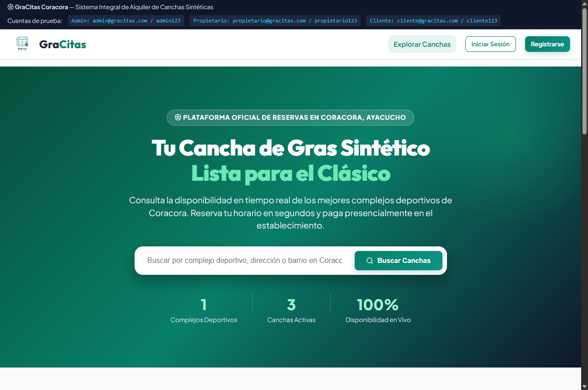

**Secciones principales:**
1. **Barra de navegación:** Permite explorar canchas, iniciar sesión o registrar una nueva cuenta.
2. **Buscador inteligente:** Permite filtrar por nombre del complejo, dirección o barrio.
3. **Indicadores en vivo:** Muestra la cantidad de canchas y complejos activos con disponibilidad al 100%.

---

### 2.2 Inicio de Sesión (`/login`)
Para ingresar a su panel de control o gestionar reservas, acceda con su correo electrónico y contraseña registrados.

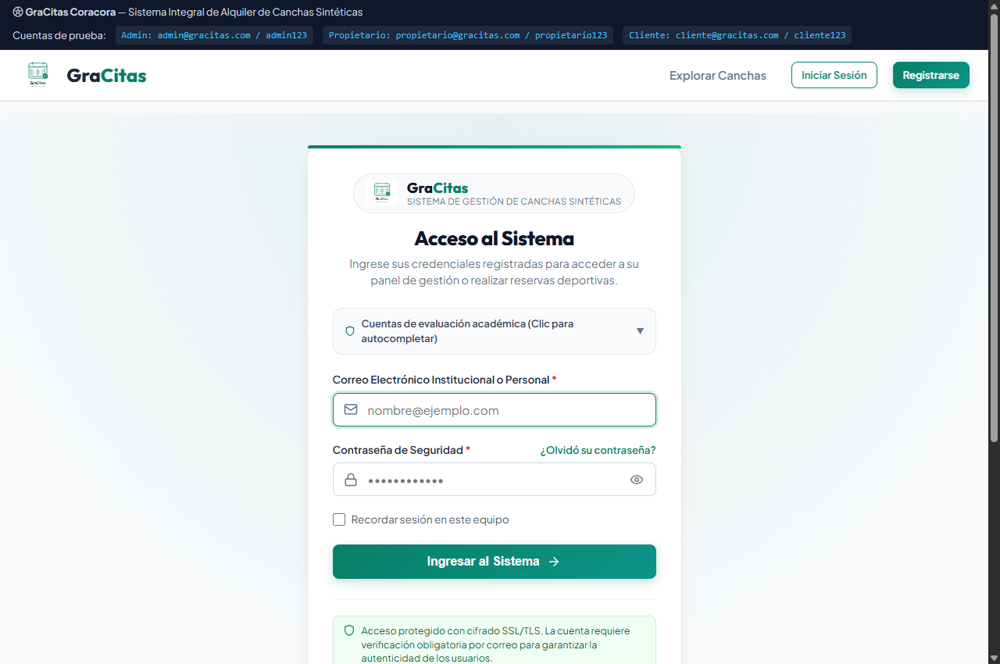

**Recomendaciones de seguridad:**
- Utilice contraseñas seguras de al menos 8 caracteres.
- Si utiliza un dispositivo personal de confianza, puede marcar la casilla **"Recordar sesión en este equipo"** para no tener que ingresar sus datos cada vez.
- En caso de olvidar su clave, pulse **"¿Olvidó su contraseña?"** para recibir un enlace seguro de restablecimiento en su correo.

---

### 2.3 Registro de Nuevos Clientes (`/register`)
Los jugadores pueden crear su cuenta en menos de un minuto completando el formulario oficial:

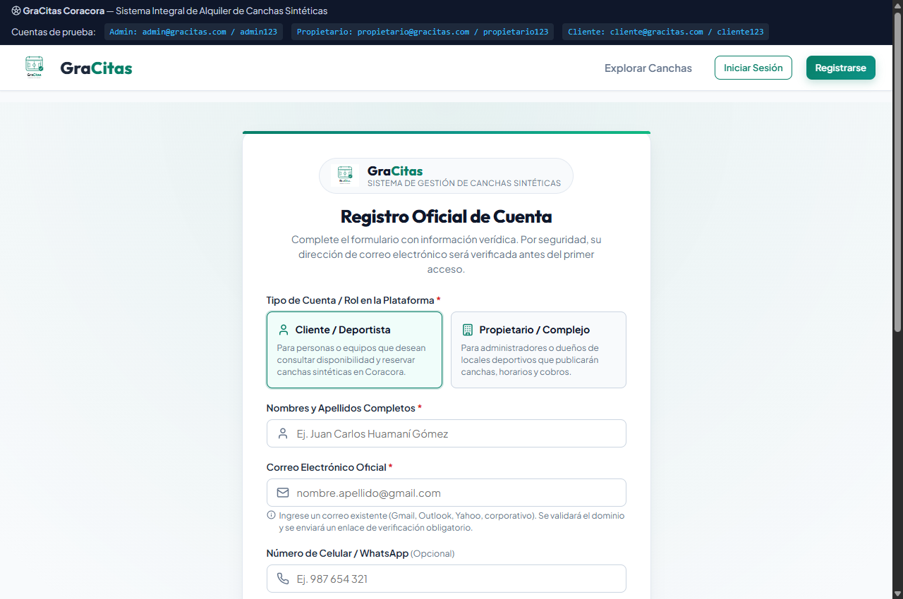

**Datos solicitados:**
- **Nombre Completo:** Para identificar al titular de la reserva.
- **Correo Electrónico:** Dirección válida donde recibirá la confirmación de sus reservas y notificaciones del sistema.
- **Teléfono / Celular:** Número de contacto (9 dígitos) para coordinaciones sobre el partido.
- **Contraseña y confirmación:** Clave personal para proteger su cuenta.

---

### 2.4 Recuperación de Contraseña (`/forgot-password`)
Si olvidó su contraseña, ingrese su correo electrónico para recibir un enlace de recuperación con un solo clic.

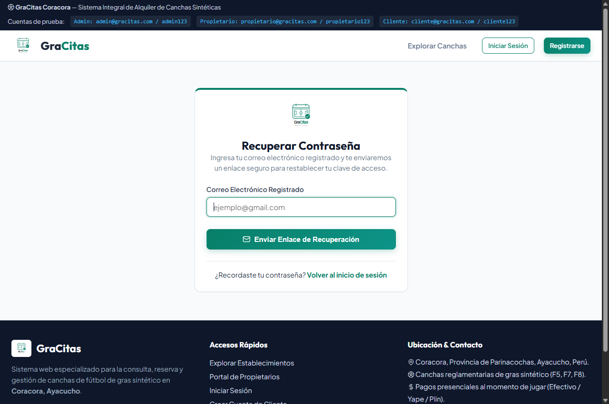

---

## 3. GUÍA PARA EL JUGADOR (CÓMO RESERVAR UNA CANCHA)

El proceso de reserva ha sido diseñado para ser ultra rápido, intuitivo y sin fricciones:

```
+-------------------+     +--------------------+     +-------------------+
| 1. Elige tu       | --> | 2. Selecciona tu   | --> | 3. Confirma tu    |
|    Cancha Favorita|     |    Horario Libre   |     |    Reserva        |
+-------------------+     +--------------------+     +-------------------+
                                                               |
                                                               v
                                                     +-------------------+
                                                     | 4. Muestra tu     |
                                                     |    Voucher y Juega|
                                                     +-------------------+
```

---

### 3.1 Explorar el Complejo Deportivo
Al seleccionar un local deportivo, podrá ver su dirección exacta, teléfonos de contacto y la lista de canchas con sus características (Fútbol 5, 7 u 8), superficie y precio por hora.

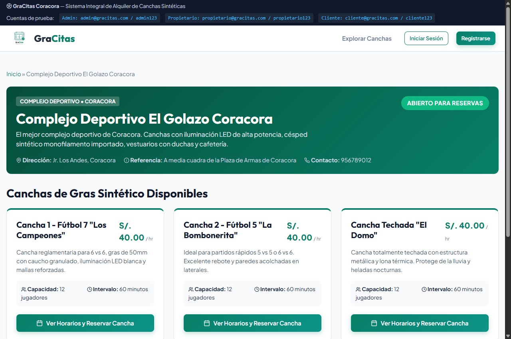

---

### 3.2 Consulta de Disponibilidad en Tiempo Real
Al hacer clic en **"Reservar Turno"**, se abre el calendario en vivo de la cancha:

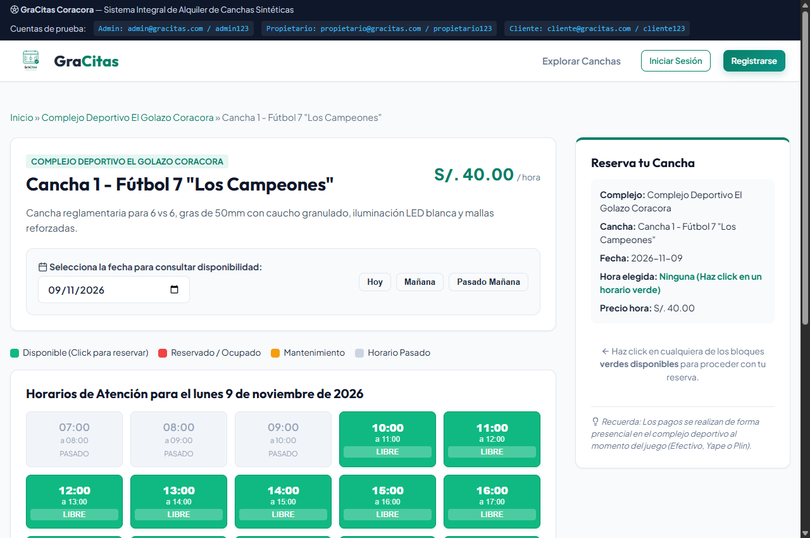

**Significado del código de colores:**
- 🟩 **Verde (Libre):** El turno está disponible. Puede hacer clic sobre él para seleccionarlo de inmediato.
- 🟥 **Rojo (Ocupado):** El turno ya fue reservado por otro equipo.
- 🟧 **Naranja (Mantenimiento):** El horario se encuentra cerrado temporalmente por mantenimiento del césped o evento privado.
- ⬜ **Gris (Pasado):** Horas que ya transcurrieron durante el día.

**Paso a paso para reservar:**
1. Seleccione la fecha deseada (Hoy, Mañana o cualquier día del calendario).
2. Elija la hora de inicio haciendo clic sobre el bloque verde correspondiente.
3. En el panel lateral derecho, elija la duración del partido (60, 90 o 120 minutos).
4. El sistema calculará automáticamente el precio total en soles (`S/.`).
5. Haga clic en **"Continuar con la Reserva"** para confirmar su turno.

---

### 3.3 Mis Reservas y Comprobante Digital
En la sección **"Mis Reservas"**, el cliente puede revisar el historial de todos sus partidos programados y descargar su comprobante oficial:

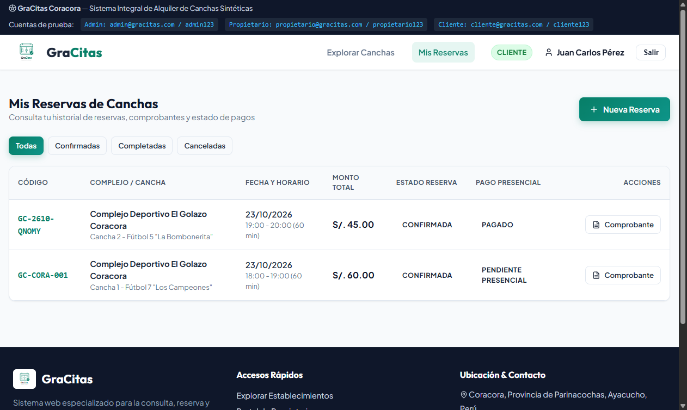

**Comprobante Digital (Voucher):**
- Contiene el **Código Único de Reserva** que identifica el turno de forma irrepetible.
- Muestra el importe pendiente de pago, la cancha, fecha y hora exacta.
- Cuenta con el botón **"Imprimir / Guardar PDF"** para guardarlo en el celular o llevarlo impreso.
- **Política de pago:** El pago se efectúa de manera presencial en recepción al llegar al complejo deportivo (Efectivo, Yape o Plin).

---

## 4. GUÍA PARA EL PROPIETARIO DEL COMPLEJO DEPORTIVO

Este módulo está destinado al dueño o administrador del complejo para el control total del negocio.

### 4.1 Dashboard del Propietario (`/propietario/dashboard`)
Es el centro de control diario. Muestra de un solo vistazo:
- **Total recaudado del mes:** Dinero cobrado por concepto de alquileres.
- **Reservas programadas para hoy:** Partidos que se jugarán durante la jornada.
- **Próximos partidos en agenda:** Lista cronológica de turnos con los datos de cada cliente.

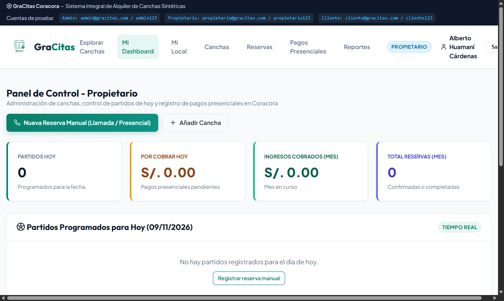

---

### 4.2 Gestión de Canchas y Horarios (`/propietario/canchas`)
Permite registrar y mantener al día las instalaciones del complejo:

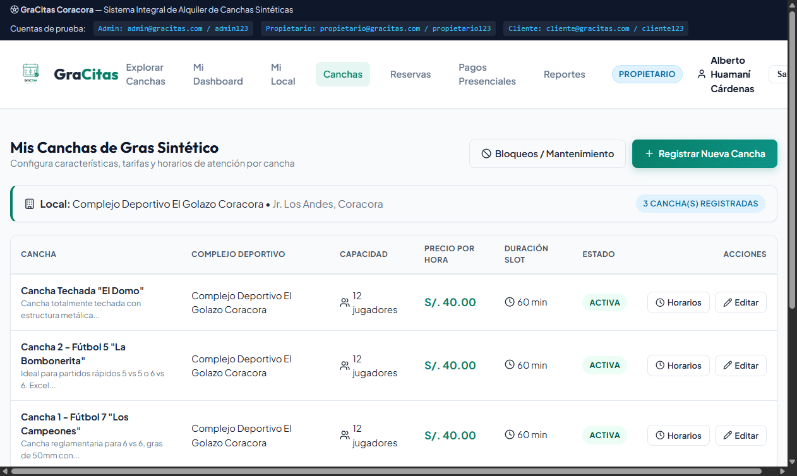

**Acciones disponibles:**
1. **Registrar Cancha:** Ingrese el nombre (ej. *"Cancha Principal"*), descripción, capacidad (ej. 10 o 14 jugadores), tarifa por hora en soles y duración mínima de turno.
2. **Configurar Horarios de Atención:** Defina para cada día de la semana (Lunes a Domingo) la hora de apertura y cierre (ej. 07:00 a 23:00). Los clientes solo podrán reservar dentro de este rango.
3. **Bloqueo por Mantenimiento:** Si necesita inhabilitar una cancha por limpieza, cepillado de caucho o lluvia, registre un bloqueo de horario indicando el motivo para evitar que el sistema permita reservas en ese lapso.
4. **Registro Manual de Reserva:** Si un cliente habitual llama por teléfono o reserva en persona, el propietario puede ingresar a *"Registro Manual"* para bloquear el horario en la web en nombre del cliente.

---

### 4.3 Control de Pagos Presenciales (`/propietario/pagos`)
Cuando los jugadores se presentan a jugar, el administrador valida el cobro:

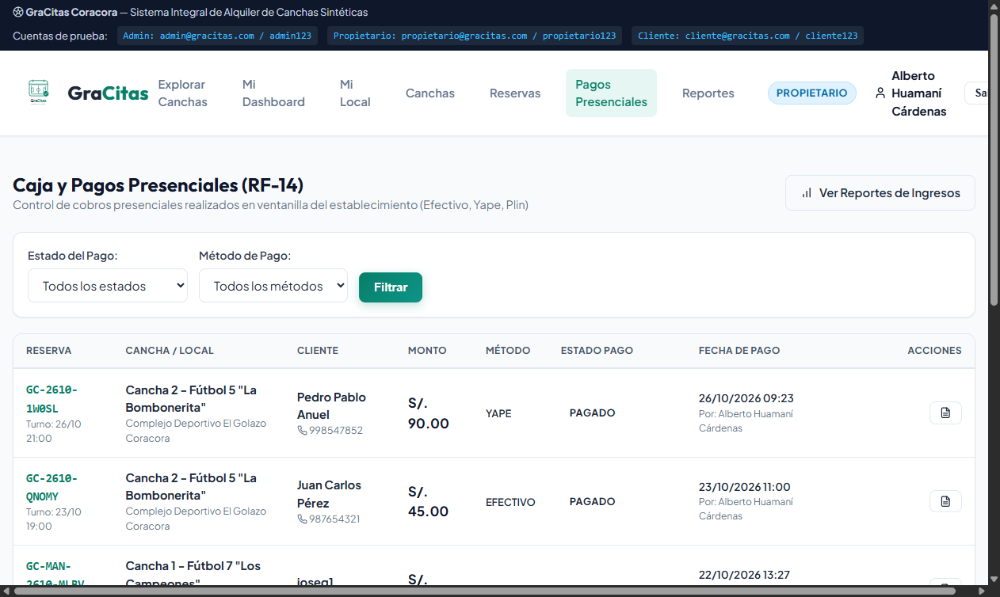

**Cómo registrar un cobro:**
1. Ubique la reserva correspondiente en la lista de cobros pendientes.
2. Pulse el botón **"Registrar Pago"**.
3. Seleccione la modalidad con la que abonó el cliente:
   - **Efectivo**
   - **Yape**
   - **Plin**
   - **Transferencia Bancaria / Otro**
4. Confirme el registro. La reserva cambiará automáticamente a estado **PAGADO** y quedará asentada en la contabilidad con la fecha, hora y usuario que recibió el dinero.

---

## 5. GUÍA PARA EL ADMINISTRADOR GENERAL

El perfil de Administrador cuenta con visibilidad integral para supervisar la operación de todos los complejos deportivos afiliados a la plataforma.

### 5.1 Dashboard Maestro (`/admin/dashboard`)
Proporciona métricas globales consolidadas:
- Cantidad total de establecimientos deportivos y canchas en funcionamiento.
- Volumen total de transacciones y facturación registrada en la plataforma.
- Crecimiento de la comunidad de deportistas y usuarios registrados.

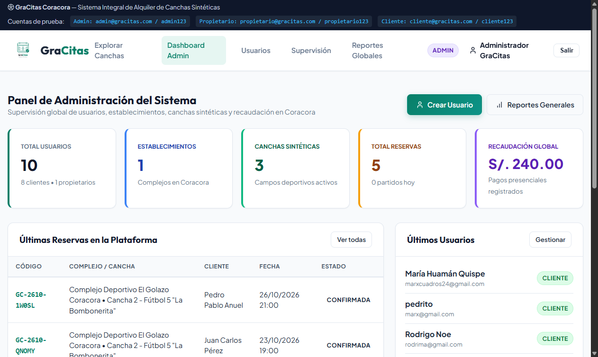

---

### 5.2 Control de Usuarios (`/admin/usuarios`)
Permite administrar las cuentas del sistema con total seguridad:

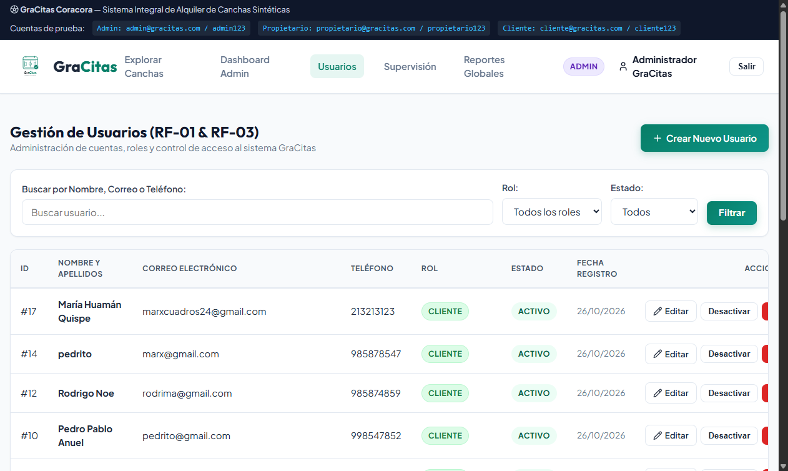

**Capacidades:**
- Dar de alta a nuevos propietarios de complejos deportivos.
- Editar datos o roles de cualquier usuario.
- **Activar / Desactivar Cuentas:** Con un solo clic en el botón de estado, puede suspender temporalmente a cualquier usuario que infrinja las normas de convivencia o presente morosidad.

---

### 5.3 Supervisión Global de Reservas (`/admin/supervision/reservas`)
Permite auditar todas las reservas que se realizan en la plataforma, filtrando por estado (`confirmada`, `completada`, `cancelada` o `no asistió`), complejo y fecha.

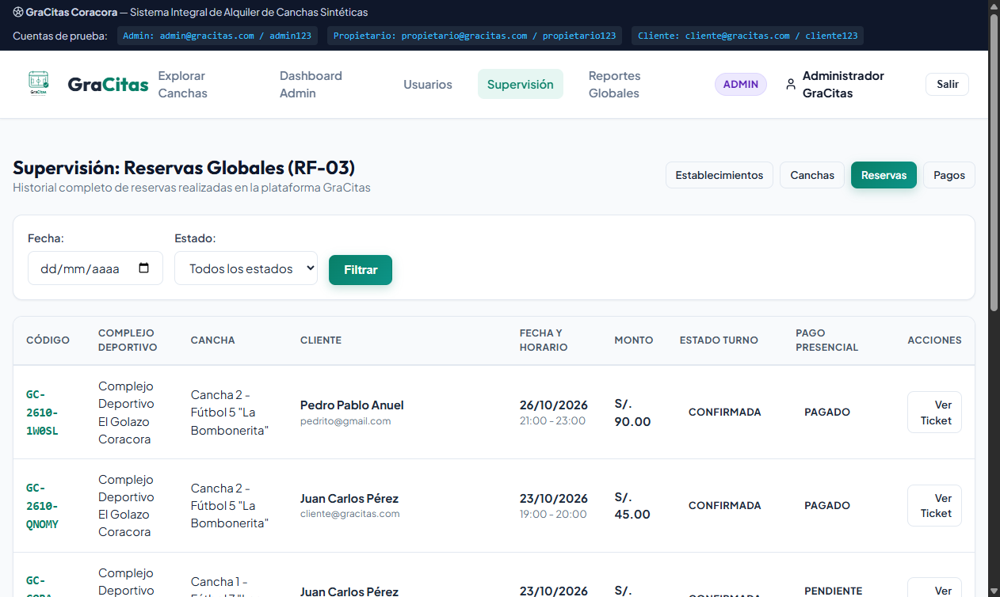

---

## 6. REGLAS DE USO Y RECOMENDACIONES OPERATIVAS

1. **Puntualidad en cancha:** Se recomienda a los jugadores presentarse 10 minutos antes de su turno para realizar el pago en recepción y evitar retrasos en el inicio del partido.
2. **Calzado reglamentario:** Por seguridad de los deportistas y conservación del césped sintético, se debe jugar con zapatillas multitaco o de suela plana de goma. Queda prohibido el ingreso con toperoles de metal.
3. **Cancelaciones:** Los clientes pueden cancelar su turno desde su panel con un mínimo de 2 horas de anticipación. Transcurrido ese plazo, el turno no podrá liberarse para no perjudicar la recaudación del complejo.
4. **Cierre de caja diario:** Se recomienda a los propietarios revisar su módulo de pagos al final del día para cuadrar el dinero en efectivo con las transferencias por Yape o Plin.

---

## 7. PREGUNTAS FRECUENTES (FAQ)

**¿Qué pasa si dos personas intentan reservar la misma cancha y hora al mismo segundo?**  
El sistema cuenta con un motor de reservas instantáneo que protege los bloques horarios: la primera persona que hace clic en confirmar asegura el turno; a la segunda persona se le notifica amablemente que el horario acaba de ser ocupado y se le ofrecen los siguientes turnos libres.

**¿El cliente tiene que pagar por adelantado con tarjeta de crédito?**  
No. GraCitas está adaptado al modelo comercial preferido por los deportistas locales: reserva en línea con confirmación inmediata y pago presencial directo en la cancha (Efectivo, Yape o Plin).

**¿Puedo utilizar GraCitas desde mi celular?**  
Sí. Todo el sistema cuenta con diseño adaptable (*responsive design*), optimizado para funcionar con total fluidez desde cualquier teléfono móvil con conexión a Internet.

---

## 8. DOCUMENTACIÓN DE API REST Y TIEMPO REAL (SWAGGER / OPENAPI 3.0)

Para integraciones externas, aplicaciones móviles o monitoreo técnico, GraCitas incluye documentación interactiva bajo el estándar **Swagger / OpenAPI 3.0.3** y canales WebSocket con **Laravel Reverb**.

### 8.1 Acceso a Swagger UI y Especificación OpenAPI
- **Portal Interactivo Swagger UI:** `/api/documentation` (permite probar peticiones directamente desde el navegador con el botón *Try it out* y autenticar tokens con *Authorize*).
- **Esquema OpenAPI 3.0 JSON:** `/api/openapi.json` (archivo estándar listo para importar en Postman, Insomnia o generadores de clientes).

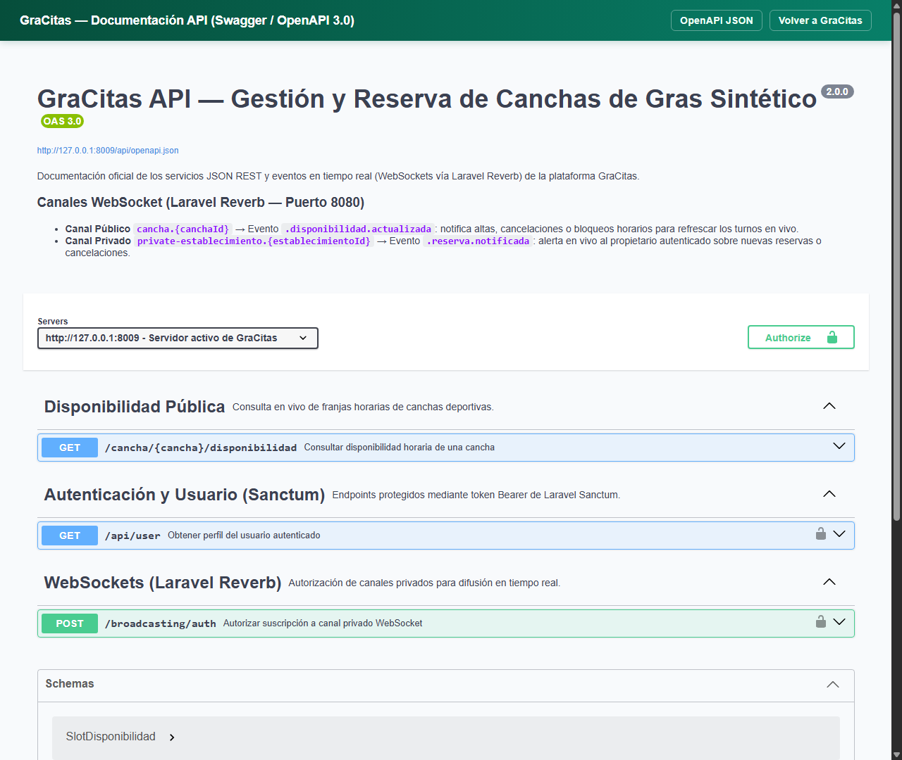

### 8.2 Endpoints REST Documentados

| Método | Ruta | Autenticación | Descripción | Respuestas |
| :--- | :--- | :--- | :--- | :--- |
| `GET` | `/cancha/{cancha}/disponibilidad?fecha=YYYY-MM-DD` | Pública | Devuelve los horarios de atención y el estado de cada franja horaria (`disponible`, `reservado`, `bloqueado`, `pasado`) de la cancha indicada. | `200 OK`, `404 Not Found`, `422 Unprocessable` |
| `GET` | `/api/user` | `Bearer Token` (Laravel Sanctum) | Retorna el perfil del usuario autenticado (`id`, `name`, `email`, `telefono`, `rol`, `activo`). | `200 OK`, `401 Unauthorized` |
| `POST` | `/broadcasting/auth` | Sesión Web (`laravel_session`) | Autoriza suscripciones a canales privados WebSocket (`socket_id`, `channel_name`) para propietarios y administradores. | `200 OK`, `403 Forbidden` |

**Ejemplo de respuesta `GET /cancha/1/disponibilidad?fecha=2026-11-12` (`200 OK`):**
```json
{
  "abierto": true,
  "hora_apertura": "07:00:00",
  "hora_cierre": "23:00:00",
  "slots": [
    {
      "inicio_hora": "18:00",
      "fin_hora": "19:00",
      "inicio_iso": "2026-11-12 18:00:00",
      "fin_iso": "2026-11-12 19:00:00",
      "disponible": true,
      "estado": "disponible",
      "detalle": "Disponible para reserva",
      "precio": 80.0
    }
  ]
}
```

### 8.3 Canales WebSocket en Tiempo Real (Laravel Reverb)

Además de los endpoints HTTP, la plataforma transmite eventos instantáneos a través de **Laravel Reverb** (puerto `8080`):

| Tipo de Canal | Nombre del Canal | Evento | Cuándo se emite |
| :--- | :--- | :--- | :--- |
| **Público** | `cancha.{canchaId}` | `.disponibilidad.actualizada` | Al crear o cancelar una reserva, o al registrar/retirar un bloqueo de horario. Actualiza la grilla de turnos en vivo. |
| **Privado** | `private-establecimiento.{establecimientoId}` | `.reserva.notificada` | Al crearse o cancelarse una reserva en el complejo. Muestra notificaciones instantáneas al propietario autenticado. |

---

*GraCitas — Tu Cancha de Gras Sintético Lista para el Clásico.*
